<!-- cards/ 由 gen.ts 生成：npm run update 拉最新数据并重新生成，然后提交推送 -->

  <picture>
    <source media="(prefers-color-scheme: dark)" srcset="cards/hero-dark.svg">
    
  </picture>

  <picture>
    <source media="(prefers-color-scheme: dark)" srcset="cards/gear-dark.svg">
    
  </picture>

  <picture>
    <source media="(prefers-color-scheme: dark)" srcset="cards/finale-dark.svg">
    
  </picture>
  &nbsp;
  <a href="https://space.bilibili.com/23360518">
    <picture>
      <source media="(prefers-color-scheme: dark)" srcset="cards/link-bilibili-dark.svg">
      
    </picture>
  </a>

